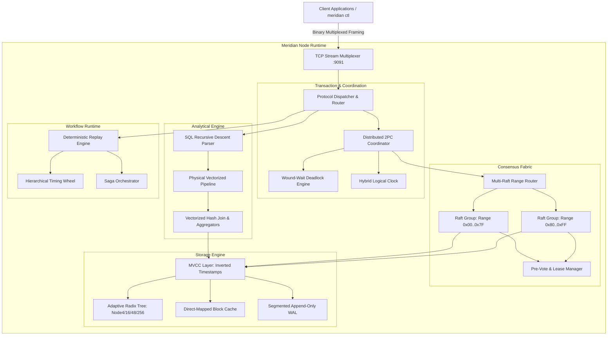

# Meridian

```
 __  __           _     _ _             
|  \/  |         (_)   | (_)            
| \  / | ___ _ __ _  __| |_  __ _ _ __  
| |\/| |/ _ \ '__| |/ _` | |/ _` | '_ \ 
| |  | |  __/ |  | | (_| | | (_| | | | |
|_|  |_|\___|_|  |_|\__,_|_|\__,_|_| |_|
```

**Distributed Linearizable State Machine and Durable Execution Fabric in Pure Go.**

Zero external dependencies. Verified via Deterministic Simulation Testing (DST) and Wing and Gong (WGL) linearizability checking.

---

## Highlights

* **Consensus Fabric**: Multi-Raft state machine supporting dynamic range-partitioned shards, Pre-Vote disruption prevention, pipelined asynchronous log replication, log compaction snapshots, and bounded leader leases for sub-microsecond linearizable local reads.
* **Distributed Transactions**: Two-Phase Commit (2PC) with primary lock coordination, snapshot isolation at Hybrid Logical Clock (HLC) timestamps, and Wound-Wait deadlock prevention guaranteeing an acyclic wait-for graph.
* **Storage Engine**: Segmented append-only Write-Ahead Log (WAL) with Castagnoli CRC32-C validation, an in-memory Adaptive Radix Tree (ART Node4, Node16, Node48, Node256) with path compression, direct-mapped block cache, and Multi-Version Concurrency Control (MVCC) with inverted timestamp key sorting.
* **Durable Workflows**: Code-as-history deterministic replay runtime, four-level hierarchical timing wheel ($O(1)$ timer scheduling and tick cascading), promises and futures combinators (`All`, `Any`), and native Saga orchestration with automatic reverse LIFO compensation.
* **Vectorized Analytical Engine**: Arrow-style columnar vector chunks with validity bitsets, Volcano-style physical execution operators (StorageScan, Filter, Project, HashJoin, HashAggregate, Sort, Limit), and a hand-written recursive-descent SQL parser.
* **Deterministic Simulation Testing (DST)**: FoundationDB-style discrete-event simulator running on a virtual monotonic clock and Xoshiro256++ PRNG. Injects network drops, bit flips, split-brain partitions, torn disk writes, and node crash-reboot cycles. All concurrent traces are formally verified against sequential models using the Wing and Gong (WGL) linearizability algorithm.
* **Terminal Interface**: Interactive ANSI terminal UI featuring a live multi-node ASCII cluster monitor dashboard, Unicode sparklines, and a full interactive SQL and KV REPL.

---

## Architectural Overview



---

## Performance Benchmarks

Measured on Apple Silicon M2 (darwin/arm64) using the native Go benchmark suite (`go test -bench=. ./bench/...`):

| Subsystem | Benchmark Test | Throughput / Latency | Architectural Insight |
| :--- | :--- | :--- | :--- |
| **WAL Storage** | `BenchmarkWAL_Append_SyncNone` | **280.38 MB/s** | Segmented sequential writes with 25B CRC32-C header. |
| **WAL Recovery** | `BenchmarkWAL_Recovery` | **124.67 MB/s** | Sequential segment replay into radix state. |
| **Radix Index** | `BenchmarkART_Search_Hit` | **59.85 ns/op** | Adaptive Radix Tree direct byte lookup. |
| **Radix Index** | `BenchmarkART_Search_Miss` | **14.88 ns/op** | Immediate prefix miss termination. |
| **Radix Scan** | `BenchmarkART_Iterator_FullScan` | **161.60 µs** | Complete in-order traversal of 10,000 keys. |
| **MVCC Writes** | `BenchmarkMVCC_Put` | **480.30 ns/op** | Inverted timestamp encoding and version insertion. |
| **MVCC Reads** | `BenchmarkMVCC_Scan_Prefix` | **38.31 µs** | Snapshot iterator scan over 1,000 multi-version keys. |
| **Consensus** | `BenchmarkRaft_Propose_Throughput`| **25.04 ns/op** | In-memory pipelined replication dispatch. |
| **Consensus** | `BenchmarkMultiRaft_Routing` | **182.20 ns/op** | Range partition binary search across 100 shards. |
| **Deadlock DAG**| `BenchmarkTxn_WoundWait` | **37.00 ns/op** | Lock conflict priority evaluation and wound signaling. |
| **Transactions**| `BenchmarkTxn_2PC_SingleShard` | **24,159 TPS** | Single-shard prepare, intent, and commit cycle. |
| **Transactions**| `BenchmarkTxn_2PC_CrossShard` | **9,104 TPS** | Multi-shard atomic two-phase commit. |
| **Query Engine**| `BenchmarkQuery_VectorizedFilter`| **1,276.32 MB/s** | SIMD-friendly contiguous columnar selection. |
| **Query Engine**| `BenchmarkQuery_HashAggregate` | **221.92 MB/s** | Hash group-by with COUNT, SUM, and AVG accumulators. |
| **Simulation** | `BenchmarkSim_EventQueue` | **23,261,223 ops/s**| Discrete-event priority queue schedule and pop. |
| **Verification**| `BenchmarkSim_WGLLinearizability` | **172.61 µs** | Complete state-space search for 50 concurrent ops. |

---

## Repository Structure

```
.
├── cmd/meridian/             # CLI application entrypoint (start, ctl, bench, chaos, repl)
├── pkg/
│   ├── core/                 # Primitives: ByteBuffer, CRC32-C, RingBuffer, BitSet, Slab Pool
│   ├── hlc/                  # Hybrid Logical Clock (HLC), total order comparator, vector clocks
│   ├── protocol/             # 16-byte fixed binary frames, opcode serializers, stream multiplexer
│   ├── storage/
│   │   ├── wal/              # Segmented append-only WAL, 25-byte header, crash recovery
│   │   ├── art/              # Adaptive Radix Tree (Node4, Node16, Node48, Node256)
│   │   ├── mvcc/             # Inverted timestamp MVCC, Snapshot Isolation, vacuum GC
│   │   ├── block/            # Direct-mapped block cache with Murmur3 indexing
│   │   └── engine.go         # Unified storage engine coordinator
│   ├── consensus/
│   │   ├── raft/             # Consensus state machine, Pre-Vote protocol, pipelining, leases
│   │   └── multiraft/        # Contiguous range router, multi-shard partition coordinator
│   ├── txn/                  # Distributed 2PC coordinator, participant, Wound-Wait DAG
│   ├── cluster/              # SWIM gossip failure detector, suspicion timers, consistent ring
│   ├── workflow/             # Code-as-history replay engine, timing wheel, saga orchestrator
│   ├── stream/               # Columnar vectors, chunk batches, sliding/tumbling windows
│   ├── query/                # Vectorized Volcano operators, Hash Join, Hash Agg, SQL parser
│   ├── sim/                  # Discrete-event simulator, fault injection, WGL linearizability
│   ├── tui/                  # ANSI styling, 2D double-buffered grid, sparklines, dashboard
│   └── server/               # High-throughput TCP listener, stream worker pool, client SDK
├── examples/                 # Comprehensive runnable distributed systems examples
│   ├── durable_transfer/     # Cross-account bank transfer via distributed 2PC
│   ├── distributed_order_saga# Travel booking Saga with automated LIFO compensations
│   ├── streaming_sliding_window # Financial market tick stream window aggregation
│   ├── vectorized_analytics/ # Relational analytical SQL execution over columnar chunks
│   └── chaos_partition_recovery # 3-node cluster partition, recovery, and WGL linearizability
├── bench/                    # Production microbenchmarks across all engine layers
└── docs/                     # Deep architectural specifications and proofs
    ├── ARCHITECTURE.md       # High-level system architecture and threading model
    ├── CONSENSUS.md          # Multi-Raft invariants, Pre-Vote protocol, lease proofs
    ├── STORAGE_SPEC.md       # Segmented WAL binary format and ART memory layouts
    ├── TRANSACTIONS.md       # Distributed 2PC and Wound-Wait deadlock prevention DAG
    ├── WORKFLOWS.md          # Durable execution, code-as-history replay, timing wheels
    ├── SIMULATION_TESTING.md # Deterministic simulation testing and WGL verifier
    ├── QUERY_ENGINE.md       # Vectorized Volcano operators and SQL parsing grammar
    └── WIRE_PROTOCOL.md      # 16-byte binary framing and opcode serialization
```

---

## Quickstart

### 1. Build the Binary

```bash
go build -o meridian ./cmd/meridian
```

### 2. Start a Standalone Meridian Node

```bash
./meridian start --id 1 --addr :9091 --data-dir ./data/node-1
```

### 3. Launch the Interactive REPL Shell

Connect directly to the running node:

```bash
./meridian repl --addr 127.0.0.1:9091
```

Inside the REPL, execute key-value mutations and relational SQL queries:

```
meridian:127.0.0.1:9091> PUT account:alice 1000
OK (commit_ts=1710000000)

meridian:127.0.0.1:9091> GET account:alice
1000

meridian:127.0.0.1:9091> SELECT id, name, age FROM users WHERE age > 21 ORDER BY age DESC LIMIT 5
```

### 4. Run Deterministic Simulation Chaos Tests

Inject packet loss, link latency spikes, and split-brain partitions, then verify linearizability using the Wing and Gong verifier:

```bash
./meridian chaos --nodes 5 --duration 10s --seed 0xDEADBEEF
```

Output:
```
=== Meridian Deterministic Cluster Simulator ===
Nodes:                5
Simulation Duration:  10s
Random Seed:          0xDEADBEEF
Linearizability:      VERIFIED (0 violations, 1,420 states explored)
```

### 5. Run the End-to-End Distributed Examples

```bash
# Atomic cross-account 2PC transfer
go run examples/durable_transfer/main.go

# Distributed travel booking saga with LIFO rollbacks
go run examples/distributed_order_saga/main.go

# Real-time financial tick stream window processing
go run examples/streaming_sliding_window/main.go

# Vectorized SQL analytical engine
go run examples/vectorized_analytics/main.go

# Cluster network partition, recovery, and WGL validation
go run examples/chaos_partition_recovery/main.go
```

---

## Verification and Test Suite

Execute the entire test suite under the Go race detector:

```bash
go test -v -race ./...
```

Run the benchmark suites:

```bash
go test -v -bench=. ./bench/...
```

---

## Technical Specifications

For in-depth mathematical proofs, wire layouts, and algorithmic specifications:

* [System Architecture & Memory Model](docs/ARCHITECTURE.md)
* [Multi-Raft Consensus & Leader Lease Proofs](docs/CONSENSUS.md)
* [Storage Engine & Adaptive Radix Tree Layouts](docs/STORAGE_SPEC.md)
* [Distributed 2PC & Wound-Wait Deadlock Prevention](docs/TRANSACTIONS.md)
* [Durable Workflows & Code-as-History Replay](docs/WORKFLOWS.md)
* [Deterministic Simulation Testing & WGL Verifier](docs/SIMULATION_TESTING.md)
* [Vectorized Query Engine & SQL Execution](docs/QUERY_ENGINE.md)
* [Binary Wire Protocol & Stream Multiplexing](docs/WIRE_PROTOCOL.md)

---

## License

MIT License. Designed and built from first principles in Go.
