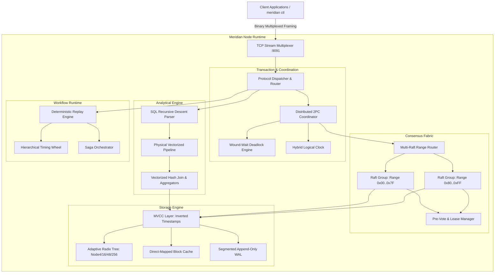

# Meridian System Architecture

Meridian is a distributed linearizable state machine and durable execution fabric written from first principles in Go. It provides transactional multi-version key-value storage, code-as-history deterministic durable workflows, pipelined Multi-Raft consensus, and a vectorized relational query engine, verified under a discrete-event deterministic simulation testing (DST) harness.

---

## Subsystem Taxonomy

Meridian organizes its runtime into modular, layered packages located within `pkg/`:

| Subsystem | Package Path | Architectural Responsibility |
| :--- | :--- | :--- |
| **Core Primitives** | `pkg/core` | Zero-allocation byte buffers, CRC32-C polynomials, slab allocators, bitsets, ring buffers. |
| **Hybrid Clocks** | `pkg/hlc` | Causally-consistent Hybrid Logical Clocks, physical drift bounds, total order comparator. |
| **Framing Protocol**| `pkg/protocol` | 16-byte fixed binary frames, opcode serializers, stream multiplexer, connection pooling. |
| **Storage Engine** | `pkg/storage` | Segmented append-only WAL, Adaptive Radix Tree (ART), MVCC, direct-mapped block cache. |
| **Consensus Fabric**| `pkg/consensus`| Raft state machine, Pre-Vote protocol, pipelined replication, leader leases, Multi-Raft partitions. |
| **Transactions** | `pkg/txn` | Two-Phase Commit (2PC), Wound-Wait deadlock prevention DAG, write intent resolution. |
| **Cluster Topology**| `pkg/cluster` | SWIM gossip failure detector, dynamic suspicion timers, consistent hash ring. |
| **Workflow Engine** | `pkg/workflow` | Code-as-history replay engine, hierarchical timing wheels, saga compensations. |
| **Stream Vectors** | `pkg/stream` | Arrow-style columnar vectors, validity bitsets, sliding/tumbling windows, watermarks. |
| **Query Engine** | `pkg/query` | Vectorized Volcano operators, recursive-descent SQL parser, Hash Join, Hash Aggregate. |
| **Simulation Test** | `pkg/sim` | Discrete-event simulator, fault-injected network/disk, WGL linearizability verifier. |
| **Terminal UI** | `pkg/tui` | ANSI terminal styling, double-buffered screen grid, Unicode sparklines, live cluster dashboard. |
| **Node Server** | `pkg/server` | High-throughput TCP listener, connection multiplexer, RPC handler, unified node coordinator. |

---

## Memory Hierarchy and Zero-Copy Data Paths

Meridian minimizes heap allocations and garbage collection pressure via specialized data structures:

1. **Slab Allocation Pool (`pkg/core/slab.go`)**: Pre-allocates uniform memory arenas to service short-lived byte slices and network payload buffers, eliminating GC sweep overhead in the write path.
2. **Direct-Mapped Block Cache (`pkg/storage/block/cache.go`)**: Maintains fixed-capacity in-memory cache blocks using Murmur3 hash indexing, caching active database segments for sub-microsecond reads.
3. **Adaptive Radix Tree Nodes (`pkg/storage/art/`)**: In-memory nodes adapt dynamically through four size classes (Node4, Node16, Node48, Node256). Each transition minimizes memory footprint while maintaining $O(k)$ key lookup speed where $k$ is key length in bytes.
4. **Columnar Vector Chunks (`pkg/stream/vector.go`)**: Relational query processing operates on typed contiguous slices (`Int64Vector`, `Float64Vector`, `StringVector`, `BoolVector`), enabling SIMD-friendly vector loops and cache line prefetching.

---

## Concurrency Model and Synchronization

The node runtime adheres to strict synchronization disciplines:

* **Lock-Free Fast Paths**: Read-mostly metadata structures leverage atomic operations (`sync/atomic`) and lock-free ring buffers for work queuing.
* **Granular Key-Range Locking**: The distributed transaction engine avoids global state locking by using a per-key `LockTable` with fine-grained mutexes and explicit expiration timestamps.
* **Deadlock Freedom via Wound-Wait**: When transaction $T_1$ requests a key locked by $T_2$, the Wound-Wait engine compares their Hybrid Logical Clock timestamps. Older transactions preempt (wound) younger ones, while younger transactions wait. This guarantees an acyclic wait-for graph and completely prevents circular deadlocks.
* **Deterministic Single-Threaded Step Execution in Simulation**: Under simulation testing (`pkg/sim`), all concurrent events are serialized through a priority event queue driven by a virtual clock, guaranteeing 100% reproducible execution traces given identical seeds.

---

## Crash Consistency and Recovery Protocol

Meridian provides durability and crash safety through a write-ahead logging protocol:

1. **Write Intent Persistence**: Every transaction intent is serialized to an append-only WAL segment with a 25-byte binary header containing CRC32-C checksums before in-memory state is updated.
2. **Segment Rollover**: When an active WAL segment reaches its configured size threshold (e.g. 64 MB), it is sealed, synchronized to disk, and a new segment is allocated.
3. **Crash Recovery Scan**: On restart, `wal.Recover()` inspects the WAL directory, sorts all segment files by base index, verifies CRC checksums, and replays valid log records into the Adaptive Radix Tree.
4. **Torn Write Truncation**: If a crash occurs mid-write, the recovery engine detects the invalid CRC32-C checksum or partial trailing frame and truncates the corrupted segment at the last valid record boundary.
