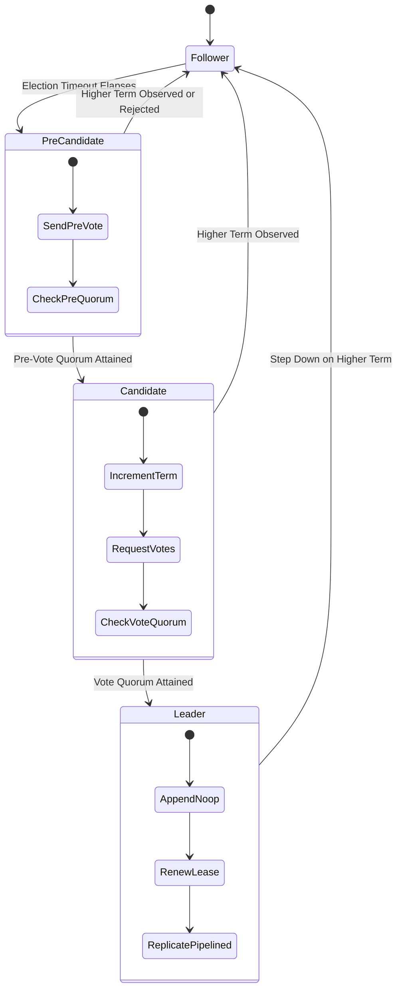

# Meridian Consensus Specification: Multi-Raft and Pre-Vote Protocol

Meridian implements a high-throughput, pipelined Multi-Raft consensus fabric. It partitions the linear key space into disjoint contiguous range shards, each replicated across an independent Raft consensus group.

---

## 1. Raft Core Invariants

The consensus fabric guarantees the following safety properties:

1. **Election Safety**: At most one leader can be elected in a given term.
2. **Leader Append-Only**: A leader never overwrites or truncates its own log entries; it only appends new entries.
3. **Log Matching Property**: If two logs contain an entry with the same index and term, then they are identical in all entries up through the given index.
4. **Leader Completeness**: If a log entry is committed in a given term, then that entry will be present in the logs of the leaders for all higher-numbered terms.
5. **State Machine Safety**: If a server has applied a log entry at a given index to its state machine, no other server will ever apply a different log entry for the same index.

---

## 2. Pre-Vote Phase Protocol

Standard Raft can experience disruptive elections when a partitioned or lagging node reconnects. The partitioned node increments its term while disconnected and forces the healthy cluster leader to step down upon receiving a higher-term `RequestVote` RPC.

Meridian eliminates disruptive elections via the **Pre-Vote Protocol**:

1. **Speculative Pre-Vote Inquiry**: When a follower's election timer elapses, it enters the `PreCandidate` state without incrementing its persistent term.
2. **Pre-Vote RPC**: The node broadcasts a `RequestVote` RPC with `IsPreVote: true` and speculative term $T_{spec} = T_{local} + 1$.
3. **Peer Evaluation**: Peers grant a pre-vote only if:
   * The candidate's log is at least as up-to-date as the peer's log.
   * The peer has not received a valid heartbeat from the current leader within the election timeout window.
4. **Quorum Transition**: Only when the node receives pre-vote grants from a strict majority quorum does it transition to `Candidate`, increment its persistent term, and initiate a real election.

---

## 3. Pipelined Asynchronous Log Replication

To maximize network utilization, Meridian decouples log replication from individual round-trip acknowledgments:

* **In-Flight Windowing**: The leader maintains an uncommitted log pipeline per follower. Multiple `AppendEntries` packets can be in-flight concurrently up to the flow control limit.
* **MatchIndex Advancements**: Followers acknowledge entries asynchronously. As acknowledgments arrive, the leader updates each peer's `MatchIndex`.
* **Quorum Commit Barrier**: The leader computes the median `MatchIndex` across all active peers. When an entry in the current term is replicated on a majority of nodes, `CommitIndex` advances and triggers state machine application.

---

## 4. Leader Leases for Low-Latency Linearizable Reads

Standard Raft requires a round-trip heartbeat to a quorum of nodes for every read operation to verify leader authority. Meridian achieves linearizable local reads without network round-trips using **Leader Leases**.

### Lease Validity Invariant

Let $T_{start}$ be the physical timestamp when the leader dispatches an `AppendEntries` heartbeat, and let $T_{lease}$ be the configured lease duration.

If a majority of nodes acknowledge the heartbeat, the leader holds a valid lease during the physical interval:

$$[T_{start}, T_{start} + T_{lease} - 2\epsilon)$$

where $\epsilon$ is the maximum bounded physical clock drift between cluster nodes (monitored by the Hybrid Logical Clock).

During this lease window:
1. No other node can receive enough votes to become leader, because healthy peers will reject votes while the leader lease remains active.
2. The leader can serve read requests locally from its in-memory MVCC storage engine without network coordination, guaranteeing strict linearizability.

---

## 5. Multi-Raft Range Partitioning

The cluster coordinates hundreds of independent Raft groups using a range-based partitioning scheme:

* **Contiguous Intervals**: The keyspace is divided into half-open intervals $[\text{StartKey}, \text{EndKey})$.
* **Range Router (`pkg/consensus/multiraft/router.go`)**: Directs incoming requests to the responsible shard using binary search over sorted range descriptors.
* **Independent Quorums**: Each shard operates its own consensus log and leader, allowing parallel write processing across distinct ranges without global contention.
