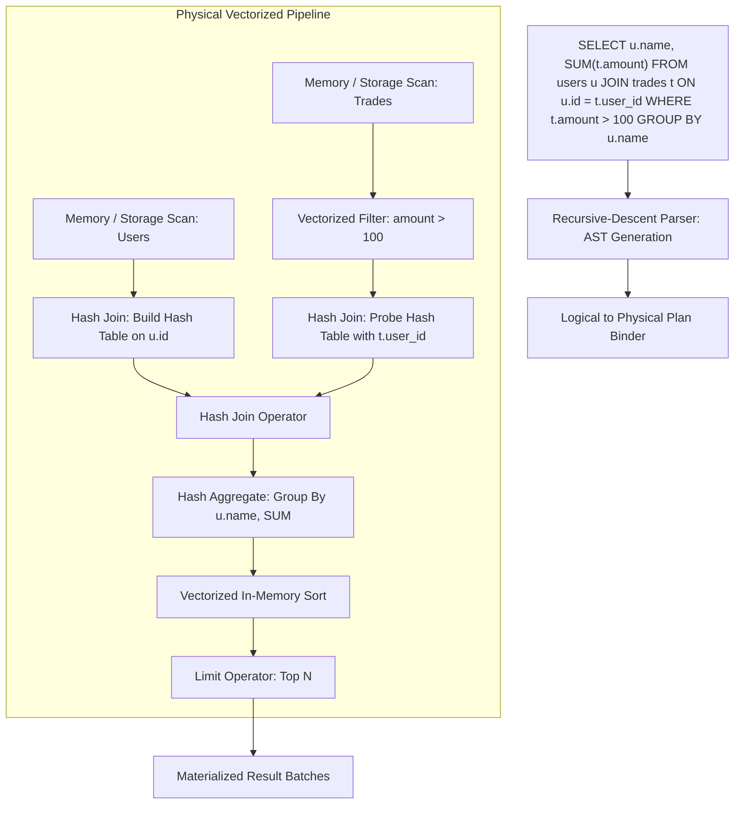

# Meridian Vectorized Query Engine Specification

Meridian incorporates an in-engine analytical query processor designed for high-throughput batch operations over multi-version data. It uses a Volcano-style iterator model extended with columnar vectorized record chunks, typed vector arrays, hash join and aggregation operators, and a recursive-descent SQL parser.



---

## 1. Columnar Vector Layouts (`pkg/stream/vector.go`)

Traditional row-by-row tuple evaluation suffers from high instruction cache miss rates and dynamic dispatch overhead. Meridian processes data in columnar vector chunks:

### Typed Vectors

Each column is backed by a specialized contiguous slice:

* `Int64Vector`: Contiguous `[]int64` buffer.
* `Float64Vector`: Contiguous `[]float64` buffer.
* `StringVector`: Contiguous byte buffer (`[]byte`) with an offsets array (`[]int32`), minimizing heap object allocations.
* `BoolVector`: Packed bitset array (`[]uint64`), packing 64 boolean flags per word.

### Validity Bitmaps

Every vector contains a parallel `BitSet` tracking null values:
* A set bit (`1`) indicates a valid, non-null value.
* A cleared bit (`0`) indicates a null entry.
* Vectorized filter and arithmetic operators process validity bitmaps with bitwise operations, skipping branch mispredictions.

---

## 2. Physical Operator Hierarchy (`pkg/query/operator.go`)

All physical operators implement the Volcano iterator interface:

```go
type Operator interface {
    Init() error
    Next() (*stream.Chunk, error)
    Close() error
    Schema() *Schema
}
```

Each call to `Next()` returns a columnar `Chunk` containing up to 1,024 rows.

### Key Physical Operators

1. **StorageScanOperator (`pkg/query/storage_scan.go`)**: Bridges the MVCC Adaptive Radix Tree to columnar query pipelines. Scans key ranges at a specified snapshot timestamp, deserializing JSON or binary payloads directly into columnar vectors.
2. **FilterOperator (`pkg/query/filter.go`)**: Evaluates binary predicate expressions over columnar chunks, constructing a selection vector without copying unselected rows.
3. **ProjectOperator (`pkg/query/project.go`)**: Computes scalar expressions and drops unused columns, forwarding only required projections to downstream operators.
4. **HashAggregateOperator (`pkg/query/aggregate.go`)**:
   * Evaluates `GROUP BY` expressions across input chunks.
   * Maintains per-group accumulators for `COUNT`, `SUM`, `MIN`, `MAX`, and `AVG`.
   * Materializes output chunks partitioned by group keys when input is exhausted.
5. **HashJoinOperator (`pkg/query/join.go`)**:
   * **Build Phase**: Reads the entire build-side input (typically the smaller relation) and constructs an in-memory hash table indexed by join key hashes.
   * **Probe Phase**: Streams probe-side chunks through the hash table, generating matching composite output chunks with minimal allocation.
6. **SortOperator (`pkg/query/sort.go`)**: Collects all upstream chunks into memory and performs multi-column sorting using quicksort with custom key comparators before emitting sorted chunks.

---

## 3. SQL Grammar and Parser (`pkg/query/parser.go`)

Meridian implements a hand-written recursive-descent SQL parser supporting standard relational queries:

```sql
SELECT <expressions>
FROM <table_name>
[WHERE <boolean_predicates>]
[ORDER BY <column> [ASC | DESC], ...]
[LIMIT <count>]
```

### Supported Syntax

* **Expressions**: Column references, numeric and string literals, binary operators (`=`, `!=`, `<`, `<=`, `>`, `>=`).
* **Logical Combinators**: `AND`, `OR`, `NOT` with proper operator precedence.
* **Aliases**: Column aliasing via optional `AS` keyword.
