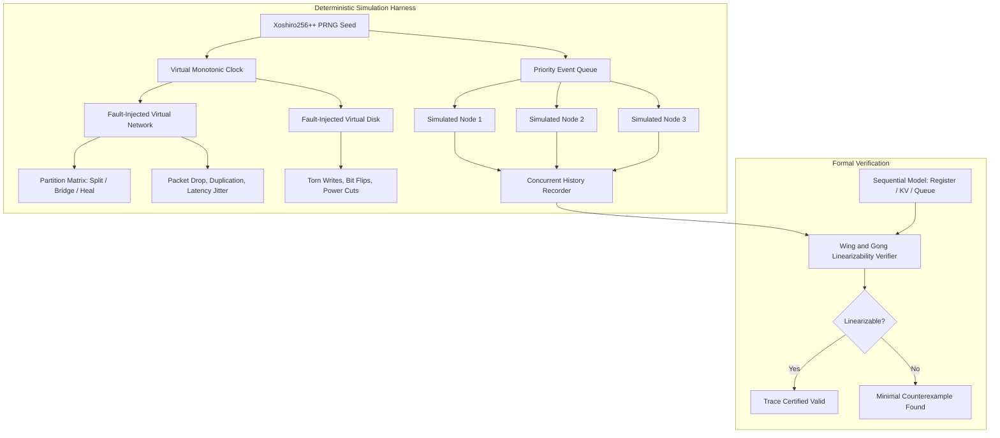

# Meridian Deterministic Simulation Testing (DST) and Verification

Meridian incorporates a discrete-event Deterministic Simulation Testing (DST) harness modeled after FoundationDB and Jepsen. It executes an entire distributed cluster within a single OS process, controlling time, concurrency, network communication, and disk I/O with 100% deterministic reproducibility.

---

## 1. Deterministic Virtual Runtime Primitives

### Discrete Event Priority Queue (`pkg/sim/events.go`)

All asynchronous operations (network packet deliveries, Raft election ticks, heartbeat timers, disk flushes) are scheduled as discrete events inside a priority queue sorted by timestamp:

* **Monotonic Step Execution**: The simulator pops the earliest scheduled event, advances the virtual clock directly to the event timestamp, and executes its closure.
* **Zero Real-World Sleep**: A simulated 24-hour cluster burn-in test completes in seconds of wall-clock CPU time.

### Xoshiro256++ PRNG (`pkg/sim/rand.go`)

All stochastic decisions (network latency jitter, packet drops, node crash timing) are generated using a high-performance Xoshiro256++ pseudorandom number generator:
* Given an initial 64-bit integer seed, two separate simulation runs will execute the exact same interleaving of events down to the microsecond.

---

## 2. Fault Injection Models

### Fault-Injected Virtual Network (`pkg/sim/network.go`)

The virtual network intercepts all inter-node RPC packets:
* **Drop Rate**: Drops packets according to a configured probability.
* **Duplication**: Generates duplicate packet deliveries with independent randomized latency.
* **Corruption**: Injects bit flips into payload bytes to test CRC32-C detection.
* **Dynamic Partition Matrix (`pkg/sim/partition.go`)**: Simulates arbitrary network splits:
  * Symmetric partitions: Two groups completely isolated from each other.
  * Asymmetric partitions: Node A can send packets to Node B, but Node B cannot send to Node A.
  * Bridge networks: Two disjoint groups communicating exclusively through an intermediate relay node.

### Fault-Injected Virtual Disk (`pkg/sim/disk.go`)

The virtual disk simulates realistic non-volatile storage failure modes:
* **Torn Writes**: Simulates sudden power loss during write operations by writing only a partial block prefix.
* **Un-synced Data Loss**: Maintains a dirty write buffer that is discarded if a crash occurs prior to an explicit `Sync()` call.
* **Bit Flips**: Introduces bit corruption into disk sectors to verify WAL recovery checksum validation.

---

## 3. Wing and Gong (WGL) Linearizability Verification

To prove cluster correctness under fault injection, Meridian implements the **Wing and Gong (WGL)** linearizability verification algorithm (`pkg/sim/verifier.go`).

### The Linearizability Invariant

A concurrent execution history is linearizable if there exists a valid sequential order $S$ of all operations such that:
1. $S$ is consistent with the sequential specification of the system model (e.g. A key-value store or atomic register).
2. For any two operations $op_1$ and $op_2$, if $op_1$ completes before $op_2$ begins in physical time ($EndNano(op_1) < StartNano(op_2)$), then $op_1$ must precede $op_2$ in the sequential order $S$.

### State-Space Search and Pruning

WGL performs a depth-first search over the partially-ordered graph of concurrent operations:
* **Linearization Points**: It searches for linearization points within each operation's half-open lifetime $[StartNano, EndNano)$.
* **Memoization**: Visited subsets of linearized operations and their resulting model states are memoized using state cache bitsets, pruning exponential search paths into polynomial runtime for typical distributed traces.
* **Counterexample Localization**: If a violation occurs (such as a stale read or phantom write), WGL terminates with a minimal counterexample trace identifying the conflicting operations and violated sequential state.
