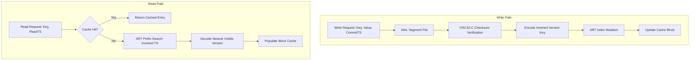

# Meridian Storage Engine Specification

The Meridian storage subsystem combines a segmented append-only Write-Ahead Log (WAL), an in-memory Adaptive Radix Tree (ART), Multi-Version Concurrency Control (MVCC) with inverted timestamp encoding, and a direct-mapped block cache.



---

## 1. Segmented Write-Ahead Log (WAL) Format

WAL records are written sequentially to immutable segmented files named according to their base index:

```
<data-dir>/wal/
  ├── segment-00000000000000000001.log
  ├── segment-00000000000000005001.log
  └── segment-00000000000000010001.log (active)
```

### Binary Record Layout

Every log record is serialized with a 25-byte fixed header followed by a variable-length payload:

```
+---------------+---------------+---------------+---------------+---------------+
| Magic (2B)    | OpType (1B)   | Term (8B)     | Index (8B)    | Length (2B)   |
+---------------+---------------+---------------+---------------+---------------+
| CRC32-C (4B)  | Payload Data (Length Bytes)...                                |
+---------------+---------------------------------------------------------------+
```

* **Magic Bytes (0x4D, 0x57)**: Identifies the file format ("MW" for Meridian WAL).
* **OpType (1 Byte)**: Operation type code (`0x01` Put, `0x02` Delete, `0x03` Batch).
* **Term (8 Bytes, uint64 big-endian)**: Raft consensus term.
* **Index (8 Bytes, uint64 big-endian)**: Raft log index.
* **Length (2 Bytes, uint16 big-endian)**: Byte count of subsequent payload data.
* **CRC32-C (4 Bytes, uint32 big-endian)**: Castagnoli polynomial checksum computed over header and payload.

---

## 2. Adaptive Radix Tree (ART) Architecture

The in-memory primary index implements an Adaptive Radix Tree, which dynamically adapts its node representations to key density:

### Node Size Classes

1. **Node4**: Holds up to 4 child pointers and 4 keys. Keys and child pointers are kept in sorted order.
2. **Node16**: Holds up to 16 child pointers and 16 keys. Keys are searched using binary search or vectorized SIMD equality comparisons.
3. **Node48**: Holds an array of 256 byte-sized indices pointing into an array of 48 child pointers. Replaces direct child pointers with indirect byte indices to minimize space.
4. **Node256**: The largest node size, storing an array of 256 child pointers indexed directly by byte value. Provides $O(1)$ child lookup.

### Path Compression and Lazy Expansion

* **Pessimistic Path Compression**: When nodes share a common prefix, the prefix bytes are stored directly inside the parent node's header (`prefix []byte`), compressing long non-branching key segments into a single node.
* **Node Growth and Shrinkage**: When a node exceeds its capacity during insertion, it is automatically replaced by the next larger node class. When deletions reduce node occupancy below the lower threshold, it shrinks back down, preserving memory efficiency.

---

## 3. MVCC Inverted Timestamp Encoding

Meridian provides Snapshot Isolation by appending new versions rather than overwriting existing records.

### Key Encoding Format

To allow the newest version of a key to sort first in the radix tree, timestamps are inverted using bitwise NOT (`^`) over the big-endian representation:

```
+--------------------------+---------------------+-----------------------+--------------+
| User Key Bytes           | Inverted Wall (8B)  | Inverted Logical (2B) | Tag (1 Byte) |
+--------------------------+---------------------+-----------------------+--------------+
```

* **Inverted Wall Time**: `^uint64(commitTS.WallTime)` in big-endian format.
* **Inverted Logical Counter**: `^uint16(commitTS.Logical)` in big-endian format.
* **Tag Byte**:
  * `0x01` (TagRecord): Active committed record.
  * `0x02` (TagTombstone): Deletion marker.
  * `0x03` (TagLock): Transactional write intent lock.

Because `^t_newer < ^t_older`, an in-order radix tree prefix scan for `UserKey` immediately encounters the latest committed version first. Point lookups complete at the first matching leaf without traversing older historical versions.

---

## 4. Garbage Collection (Vacuum Protocol)

Historical versions and tombstones accumulate over time. The vacuum engine (`pkg/storage/mvcc/vacuum.go`) scans the index against a cluster-wide safe garbage collection watermark ($T_{watermark}$):

1. **Active Key Retention**: For each user key, the newest version created at or before $T_{watermark}$ is preserved.
2. **Obsolete Version Reclamation**: All versions older than the preserved version are deleted from the radix tree.
3. **Tombstone Pruning**: If the newest version at or before $T_{watermark}$ is a tombstone, both the tombstone and all older versions are permanently expunged.
