# Meridian Distributed Transactions: 2PC and Wound-Wait Deadlock Prevention

Meridian provides atomic, linearizable multi-shard transactions across distributed state machines. It integrates a distributed Two-Phase Commit (2PC) coordinator with the Wound-Wait deadlock prevention algorithm and Hybrid Logical Clock timestamps.

```mermaid
sequenceDiagram
    autonumber
    participant Client as Client Application
    participant Coord as 2PC Coordinator
    participant P1 as Participant Shard 1 (Primary)
    participant P2 as Participant Shard 2 (Secondary)

    Client->>Coord: Begin(Isolation=Snapshot)
    Coord-->>Client: TxnContext (StartTS)
    
    Client->>Coord: Put(KeyA, ValA), Put(KeyB, ValB)
    Note over Coord: Buffer mutations locally
    
    Client->>Coord: Commit()
    
    rect rgb(30, 40, 60)
        Note over Coord,P2: Phase 1: Prepare & Lock Acquisition
        Coord->>P1: Prepare(TxnID, KeyA, ValA, StartTS)
        P1->>P1: Acquire Lock & Write Intent
        P1-->>Coord: Prepared(OK)
        
        Coord->>P2: Prepare(TxnID, KeyB, ValB, StartTS)
        P2->>P2: Acquire Lock & Write Intent
        P2-->>Coord: Prepared(OK)
    end
    
    rect rgb(40, 60, 40)
        Note over Coord,P2: Phase 2: Commit & Intent Resolution
        Coord->>P1: CommitIntent(TxnID, CommitTS)
        P1->>P1: Promote Intent to Visible Version & Release Lock
        P1-->>Coord: Committed(OK)
        
        Coord->>P2: CommitIntent(TxnID, CommitTS)
        P2->>P2: Promote Intent to Visible Version & Release Lock
        P2-->>Coord: Committed(OK)
    end
    
    Coord-->>Client: Transaction Committed (CommitTS)
```

---

## 1. Wound-Wait Deadlock Prevention

Distributed 2PC systems often suffer from distributed deadlocks when transactions acquire locks across shards in varying orders. Meridian uses the **Wound-Wait** algorithm to prevent deadlocks without distributed cycle-detection overhead.

### Priority Rules

Each transaction is assigned a priority based on its Hybrid Logical Clock timestamp at creation ($StartTS$). An older timestamp denotes higher priority.

When transaction $T_{requester}$ attempts to acquire a lock held by transaction $T_{holder}$:

$$\text{Action} = \begin{cases} 
\text{WOUND} & \text{if } StartTS(T_{requester}) < StartTS(T_{holder}) \text{ (Requester is older)} \\
\text{WAIT} & \text{if } StartTS(T_{requester}) \ge StartTS(T_{holder}) \text{ (Requester is younger)}
\end{cases}$$

1. **Wound (Preemption)**: If the requesting transaction is older, it wounds the younger lock holder. The younger holder is marked as wounded and aborts its operation, releasing its locks for the older transaction.
2. **Wait (Passive Queueing)**: If the requesting transaction is younger, it is permitted to wait for the older holder to finish.

### Proof of Deadlock Freedom

1. In any wait relationship $T_{younger} \to T_{older}$, edge directions strictly point from younger transactions to older transactions.
2. A directed cycle $T_1 \to T_2 \to \dots \to T_n \to T_1$ requires:
   $$StartTS(T_1) > StartTS(T_2) > \dots > StartTS(T_n) > StartTS(T_1)$$
3. Since Hybrid Logical Clocks define a strict total order over all timestamps, such a cycle is mathematically impossible. The wait-for graph is strictly acyclic, guaranteeing deadlock freedom.

---

## 2. Distributed Two-Phase Commit (2PC) Protocol

The coordinator manages transaction lifecycles using the following state machine:

### Phase 1: Prepare

1. **Intent Staging**: The coordinator identifies all participant shards involved in the transaction's read and write sets.
2. **Designation of Primary Key**: The first key written is designated as the transaction's primary lock. All secondary locks store a reference pointing to the primary key.
3. **Prepare Broadcast**: The coordinator sends `Prepare` RPCs in parallel to all participant shards.
4. **Lock Acquisition & Validation**: Each participant verifies:
   * No newer committed version exists at a timestamp greater than $StartTS$ (write-write conflict check).
   * The lock is acquired successfully via Wound-Wait.
   * If all checks pass, the shard writes an uncommitted intent record and returns a vote of `Prepared`.

### Phase 2: Commit or Abort

1. **Quorum Agreement**: If all participants return `Prepared`, the coordinator commits the transaction:
   * The coordinator writes a commit record to the primary shard with $CommitTS = \max(StartTS, HLC.Now())$.
   * Once the primary shard commits, the transaction is logically committed.
2. **Secondary Intent Resolution**: The coordinator asynchronously dispatches `CommitIntent` RPCs to all secondary participants. Each secondary promotes the staged intent to a visible committed version and releases its lock.
3. **Rollback on Failure**: If any participant rejects the prepare phase (e.g. Due to conflict or timeout), the coordinator issues `Rollback` RPCs to all participants, removing all staged intents and releasing locks.

---

## 3. Snapshot Isolation and Read Path Semantics

Meridian implements Snapshot Isolation (SI):

* **Read Timestamp**: Transactions read from a consistent snapshot taken at their $StartTS$.
* **Lock-Free Reads**: Reading transactions do not acquire shared read locks. They traverse the MVCC index to locate the newest version where $VersionTS \le ReadTS$.
* **Write Intent Encounters**: If a reader encounters an uncommitted write intent from another transaction, it inspects the status of the primary lock:
  * If the primary lock has committed, the reader treats the intent as committed at its commit timestamp.
  * If the primary lock is aborted or missing, the reader ignores the intent.
  * If the transaction is still in-flight, the reader waits or evaluates Wound-Wait rules.
