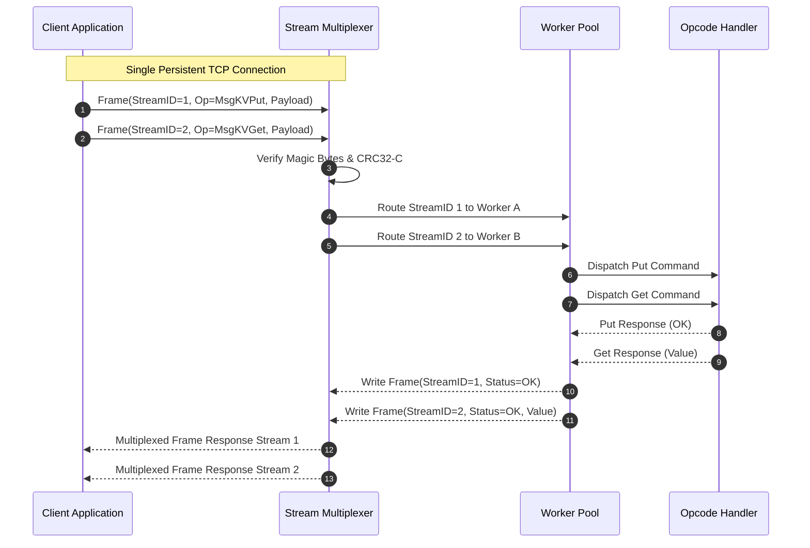

# Meridian Binary Wire Protocol Specification

Meridian uses a custom, zero-copy binary wire protocol optimized for high-throughput stream multiplexing and low serialization overhead. All inter-node cluster messages and client SDK interactions operate over persistent TCP connections using this protocol.



---

## 1. Frame Binary Layout

Every transmission unit is serialized into a 16-byte fixed header followed by a variable-length payload:

```
+---------------+---------------+---------------+---------------+
| Magic (2B)    | Version (1B)  | Flags (1B)    | Opcode (2B)   |
+---------------+---------------+---------------+---------------+
| StreamID (4B)                                 | PayloadLen (2B)|
+-----------------------------------------------+---------------+
| CRC32-C (4B)                                                  |
+---------------------------------------------------------------+
| Payload Data (PayloadLen Bytes)...                            |
+---------------------------------------------------------------+
```

### Header Field Definitions

| Field | Size | Type | Description |
| :--- | :--- | :--- | :--- |
| **Magic** | 2 Bytes | `[2]byte` | Protocol identifier. Fixed to ASCII `"MD"` (`0x4D, 0x44`). |
| **Version** | 1 Byte | `uint8` | Protocol version. Current version is `0x01`. |
| **Flags** | 1 Byte | `uint8` | Bitmask: `0x01` IsResponse, `0x02` IsHeartbeat, `0x04` Compressed. |
| **Opcode** | 2 Bytes | `uint16` | Operation command identifier (big-endian). |
| **StreamID** | 4 Bytes | `uint32` | Logical multiplexed stream identifier (big-endian). |
| **PayloadLen**| 2 Bytes | `uint16` | Length of payload data in bytes (0 to 65,535). |
| **CRC32-C** | 4 Bytes | `uint32` | Castagnoli CRC32 checksum computed over header and payload. |

---

## 2. Protocol Opcodes and Subsystem Routing

Meridian groups opcodes into distinct functional ranges:

### Consensus Opcodes (`0x0001` - `0x000F`)

* `0x0001` (`MsgPreVote`): Pre-vote speculative election inquiry.
* `0x0002` (`MsgRequestVote`): Formal Raft candidate vote request.
* `0x0003` (`MsgRequestVoteResp`): Candidate vote response with granted status.
* `0x0004` (`MsgAppendEntries`): Pipelined log entry replication batch.
* `0x0005` (`MsgAppendEntriesResp`): Follower match index and commit acknowledgment.
* `0x0006` (`MsgHeartbeat`): Leader lease renewal and keepalive ping.
* `0x0007` (`MsgInstallSnapshot`): Compaction snapshot chunk transfer.

### Transaction Opcodes (`0x0010` - `0x001F`)

* `0x0010` (`MsgTxnPrepare`): Phase 1 2PC prepare request.
* `0x0011` (`MsgTxnPrepareResp`): Phase 1 vote (Prepared, Aborted, or Wounded).
* `0x0012` (`MsgTxnCommit`): Phase 2 2PC commit directive.
* `0x0013` (`MsgTxnRollback`): Phase 2 2PC rollback directive.
* `0x0014` (`MsgTxnHeartbeat`): Client transaction coordinator lease renewal.

### Key-Value Storage Opcodes (`0x0020` - `0x002F`)

* `0x0020` (`MsgKVGet`): Snapshot point lookup by key and read timestamp.
* `0x0021` (`MsgKVPut`): Put key-value pair under transaction or standalone commit.
* `0x0022` (`MsgKVDelete`): Record deletion tombstone.
* `0x0023` (`MsgKVScan`): Prefix range scan with limit and snapshot timestamp.

### Durable Workflow Opcodes (`0x0030` - `0x003F`)

* `0x0030` (`MsgWorkflowStart`): Initialize a new durable workflow instance.
* `0x0031` (`MsgWorkflowSignal`): Deliver external event or signal to active workflow.
* `0x0032` (`MsgWorkflowQuery`): Read workflow execution state without replay mutation.

### Analytical Query Opcodes (`0x0040` - `0x004F`)

* `0x0040` (`MsgQueryExecute`): Execute SQL statement and open result stream cursor.
* `0x0041` (`MsgQueryNext`): Fetch next columnar record chunk from active cursor.

---

## 3. Stream Multiplexing and Flow Control

A single persistent TCP connection multiplexes thousands of concurrent asynchronous requests:

* **Independent Streams**: Requests carry a unique `StreamID`. Responses can return out of order without head-of-line blocking across distinct streams.
* **Stream Reuse**: After a response frame is delivered, the `StreamID` is recycled into the connection's free stream pool.
* **Heartbeat Frames**: When no data packets are transmitted for a configured interval, nodes send lightweight heartbeat frames (`Flags: 0x02`) to verify link liveness and update SWIM failure suspicion timers.
