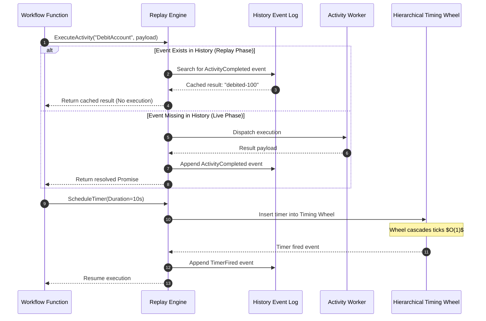

# Meridian Durable Execution and Workflow Specification

Meridian incorporates an in-engine durable execution fabric that allows long-running distributed workflows to be defined as plain code. Execution state, activity results, and timers are recorded into an append-only history log, enabling deterministic code-as-history replay across process crashes and network partitions.



---

## 1. Code-as-History Deterministic Replay

Durable workflows survive machine failures by re-executing workflow code from the beginning using a recorded event log:

### Event Log Taxonomy

The execution history contains structured sequence events (`pkg/workflow/event.go`):

1. `EventWorkflowStarted`: Marks entry into the workflow function with initial parameters.
2. `EventActivityScheduled`: Captures an invocation request for a named activity.
3. `EventActivityCompleted`: Records successful completion and output payload of an activity.
4. `EventActivityFailed`: Records an activity error, enabling retry policies.
5. `EventTimerStarted`: Records the schedule of a durable sleep or timeout.
6. `EventTimerFired`: Records expiration of a timer.
7. `EventWorkflowCompleted`: Records final return value.
8. `EventWorkflowFailed`: Records terminal failure.

### Replay Deduplication Invariant

When recovering from a crash:
* The workflow function is invoked from line 1.
* When `ctx.ExecuteActivity(name, input)` is reached, the replayer scans the event history at the current event cursor.
* If a corresponding `EventActivityCompleted` exists, the replayer returns the recorded output immediately as an already-resolved promise. The activity worker is never re-invoked.
* If no recorded event exists, the replayer switches to live execution, scheduling the task on an activity worker and persisting the resulting event upon completion.

### Determinism Rules for Workflow Code

To ensure replay generates identical execution paths, workflow functions must satisfy strict determinism constraints:
1. No direct wall-clock lookups: Use `ctx.Now()` (virtual time) instead of `time.Now()`.
2. No non-deterministic random numbers: Use deterministic PRNG seeded from workflow context.
3. No direct unrecorded network or disk I/O: All side effects must be wrapped inside registered activities.

---

## 2. Hierarchical Timing Wheel Architecture

Durable timers are scheduled efficiently using a multi-level hierarchical timing wheel (`pkg/workflow/wheel.go`):

```
Wheel Level 0 (Milliseconds): 256 slots, 1 ms resolution, range 0..255 ms
Wheel Level 1 (Seconds):      64 slots, 256 ms resolution, range 0..16.38 s
Wheel Level 2 (Minutes):      64 slots, 16.38 s resolution, range 0..17.47 m
Wheel Level 3 (Hours):        64 slots, 17.47 m resolution, range 0..18.64 h
```

### Cascading Mechanics

* **$O(1)$ Insertion**: Timers are inserted into the appropriate wheel level based on expiration delta using bitwise shifts.
* **Tick Advances**: When a lower wheel completes a full rotation, it triggers a cascade step on the next higher wheel. Timers residing in the current higher-wheel slot are migrated down to their precise slot in the lower wheel.
* **Zero Timer Polling**: Execution is triggered strictly by wheel advancement rather than linear timer scanning.

---

## 3. Distributed Saga Orchestration and Compensation

For multi-step distributed operations that cross trust or storage boundaries, Meridian provides a native Saga orchestrator (`pkg/workflow/saga.go`):

1. **Forward Steps**: As forward activities succeed (e.g. Reserve inventory, authorize payment), reverse compensation functions are registered with the saga:
   ```go
   ctx.Saga().AddStep("ReleaseInventory", func() error {
       return ctx.ExecuteActivity("ReleaseInventory", payload, opts).Get()
   })
   ```
2. **Reverse LIFO Unwinding**: If a subsequent forward activity fails or experiences an irrecoverable error, the saga orchestrator unwinds all registered compensations in reverse Last-In-First-Out (LIFO) order.
3. **Idempotence and Safety**: Executed compensations are consumed and purged from the saga stack, guaranteeing that subsequent compensation invocations do not duplicate side-effects.
